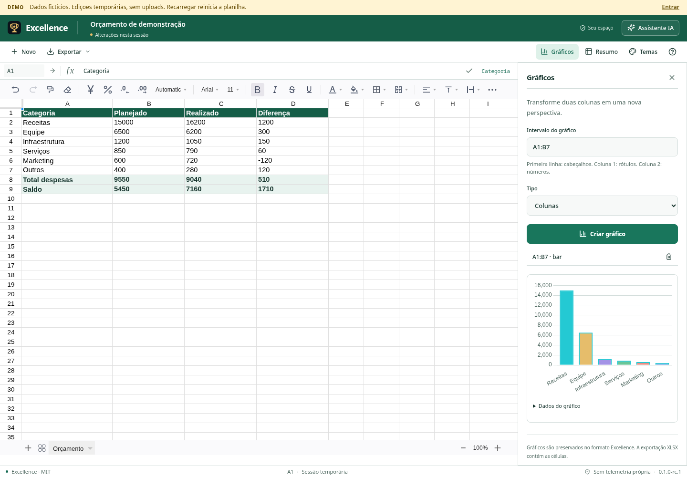
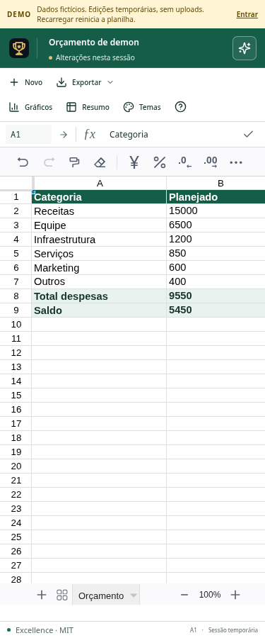

# Excellence

**Planilhas livres, célula por célula.** Símbolo de troféu, licença MIT e seus dados na sua infraestrutura.

Versão **0.1.0-rc.1**. Aplicativo funcional para homologação. Não é uma implementação integral do Microsoft Excel. Veja [compatibilidade](docs/COMPATIBILITY.md) e [validação](docs/VALIDATION.md) antes de adotar em produção.

**Acessar:** [exc.securityops.co](https://exc.securityops.co) · [exc.securityops.com.br](https://exc.securityops.com.br) · [Experimentar a demonstração](https://exc.securityops.co/demo). [English documentation](README.md).



A demonstração permite editar uma planilha de exemplo sem conta. Ela não aceita uploads, não acessa arquivos privados e não grava as planilhas no servidor. Recarregar descarta as mudanças. O assistente local opcional tem cotas compartilhadas aplicadas no servidor, limites de entrada e tempo de resposta; as propostas precisam ser revisadas antes da aplicação.

<details><summary>Interface em tela pequena</summary>



</details>

## Começar em 1 comando

Extraia o pacote. No diretório extraído, com Docker e Compose instalados:

```sh
docker compose up -d --build
```

Abra **http://localhost:3210**. Para obter o token de instalação de uso único:

```sh
docker compose logs excellence
```

Crie o administrador com o token e uma senha de pelo menos 12 caracteres. Não há senha padrão nem cadastro público. O serviço é publicado em loopback por padrão. Os dados ficam no volume `excellence-data`, preservado ao recriar o contêiner. `docker compose down -v` apaga esse volume; não use para atualizar.

## GNU/Linux

Requer **Node.js 24 LTS** e um navegador moderno. O pacote distribuído inclui o build; não é necessário instalar dependências npm para usá-lo.

```sh
sh install.sh
```

Abra **Excellence** no menu de aplicativos. Para usar sem instalar:

```sh
node scripts/launch.mjs
```

O terminal mostra o token inicial e permanece aberto enquanto o aplicativo está em uso. GNU Guix funciona com um perfil que forneça Node 24; a distribuição não depende de `/usr/bin/node`, Electron, um runtime proprietário ou bibliotecas binárias npm. Não é entregue um pacote Scheme para os canais do Guix.

## Windows

Instale Node.js **24 LTS**. Obtenha o fonte do repositório e clique em `Start-Excellence.cmd` para executar sem instalar, ou rode no PowerShell no diretório do projeto:

```powershell
powershell -NoProfile -ExecutionPolicy Bypass -File .\Install-Windows.ps1
```

O instalador cria um atalho no menu Iniciar. Não exige privilégios de administrador. A interface usa o navegador instalado; não há EXE/MSI nativo nesta distribuição. O script Windows foi inspecionado e possui CI preparado, mas não foi executado em um Windows nesta entrega.

## Recursos implementados

- Grade FortuneSheet: abas, fórmulas, edição, copiar/colar, desfazer/refazer, fontes, cores, bordas, mesclagem, filtros, ordenação, validação, comentários e congelamento.
- Importação e exportação XLSX, CSV e formato nativo Excellence JSON. Aviso de conversão antes da importação e proteção contra fórmulas perigosas na exportação CSV.
- Gráficos de colunas, linhas e rosca; resumos por grupo com soma, média, contagem, mínimo ou máximo.
- Cinco temas: Meia-noite, Papel, Grafite, Ametista e Oceano. Células escuras opcionais com transformação apenas visual de cores.
- Contas isoladas, administrador, mudança de senha, remoção de usuários, atividades recentes e salvamento automático.
- Revisões otimistas: duas sessões não sobrescrevem silenciosamente o mesmo arquivo. Histórico de até 20 versões, restauração e recuperação local de rascunhos quando o navegador tem espaço disponível.
- IA com OpenAI-compatible, Anthropic, Gemini e Ollama. Somente a seleção revisada é enviada após solicitação; propostas exigem aplicação explícita. Chaves ficam no servidor.
- Servidor Node com SQLite; sem dependências npm no runtime empacotado. Sem CDN ou telemetria própria durante o uso normal. Provedores de IA externos têm seus próprios termos e custos.

## Desenvolvimento

```sh
npm ci --ignore-scripts
npm test
npm run build
npm start
```

Para edição com Vite, execute `npm start` em um terminal e `npm run dev` em outro. A distribuição usa Node 24 e versões npm travadas. `npm run build` aplica um patch reprodutível no FortuneSheet para inserir linhas sem `new Function`, manter seleções imutáveis e corrigir avaliação de literais lógicos, divisão e recálculo pela API. A política CSP continua sem `unsafe-eval`. Avisos e licenças de terceiros estão em `THIRD_PARTY_NOTICES.txt`.

Testes de navegador:

```sh
npx playwright install chromium
npm run test:e2e
```

O fluxo de CI para Linux e Windows e o build Docker está em `.github/workflows/ci.yml`. Ele precisa ser executado em um repositório Git; sua presença não significa que houve execução externa nesta entrega.

## Documentação

- [Operação, proxy HTTPS, backup e restauração](docs/OPERATIONS.md)
- [Integração com LLMs](docs/LLM.md)
- [Compatibilidade e limites](docs/COMPATIBILITY.md)
- [Relatório de validação e parecer](docs/VALIDATION.md)

## Licença

Consulte também a [verificação de integridade CodeMark](docs/INTEGRITY.md).

MIT. Uso pessoal e comercial, modificação e redistribuição permitidos com os avisos da licença. As licenças das dependências continuam aplicáveis. O uso de provedores externos de IA pode ter custo; não há cobrança implementada pelo Excellence.
